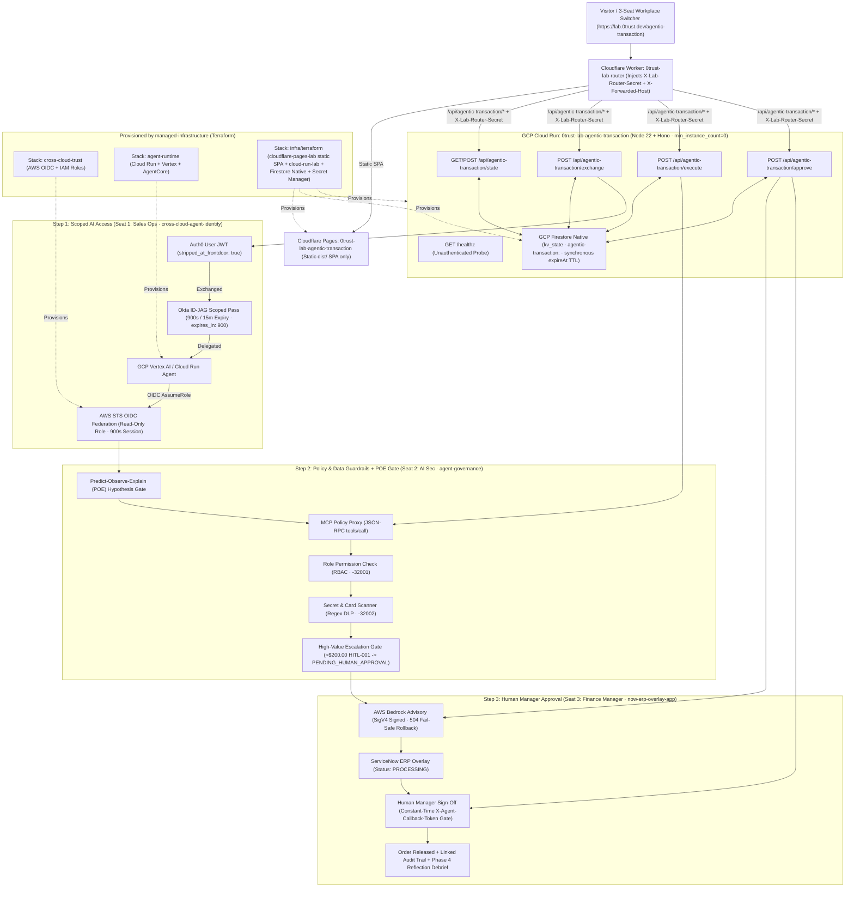

# Lab 2 Architecture: Controlled AI Financial Actions (`/agentic-transaction`)

> **Zoom Level:** 2.5 (Lab Assembly + Infrastructure Mapping)  
> **Parent Overview:** [`docs/ARCHITECTURE.md`](../ARCHITECTURE.md)
> **Experience Shell:** Compact AppShell with dropdown [`RoleSwitcherBar`](../src/components/RoleSwitcherBar.tsx) (*Sarah Chen · Sales Ops · ApexCRM + AI Copilot* ↔ *Marcus Thorne · AI Security · Agent Activity Monitor* ↔ *Elena Vance · Finance Manager · Finance Approval Inbox*), [`driver.js`](https://driverjs.com/) orientation tour (`Lab Tour`), and sticky-bottom [`XRayTelemetryDrawer`](../src/components/XRayTelemetryDrawer.tsx).

---

## 1. End-to-End Lab + `managed-infrastructure` Zoom-In

---

## 2. Distributed Repo & Infrastructure Ownership

| Lab Stage & Seat | Plain-English Purpose | Owning Application Repo | Provisioning Infrastructure (`managed-infrastructure`) |
| :--- | :--- | :--- | :--- |
| **Step 1: Scoped AI Access** *(Seat 1: Sales Ops · CRM + AI Copilot)* | Strip raw login at frontdoor (`stripped_at_frontdoor: true`) and issue a 15-minute (`900s`) single-purpose pass (`expires_in: 900`) | [`cross-cloud-agent-identity`](https://github.com/c2pig/cross-cloud-agent-identity) | `cross-cloud-trust` (AWS OIDC Provider & IAM Role) + `agent-runtime` (GCP Cloud Run / Vertex) |
| **Step 2: Policy & Data Guardrails** *(Seat 2: AI Sec · MCP Console + POE Gate)* | Predict-Observe-Explain check, block leaked secrets (`-32002`) & unauthorized roles (`-32001`), escalate high-value orders (`>$200.00` `HITL-001`) | [`agent-governance`](https://github.com/c2pig/agent-governance) | `agent-runtime` (MCP Policy Proxy & Default-Deny Egress) |
| **Step 3: Human Manager Approval** *(Seat 3: Finance Manager · Approval Queue)* | AI generates SigV4 Bedrock advisory (`PROCESSING`); only constant-time authenticated human callback can set `RELEASED` | [`now-erp-overlay-app`](https://github.com/c2pig/now-erp-overlay-app) | `cross-cloud-trust` (Bedrock SigV4 IAM Role) + ServiceNow Fluent App |
| **Lab UI & Cloud Run API Backend** | Static SPA on Cloudflare Pages (`dist/`), Node 22 + Hono API on GCP Cloud Run (`server/app.ts` wrapping `/api/agentic-transaction/{state,exchange,execute,approve}`), Firestore Native `kv_state` (`1h TTL` + daily cap `lab2:cap:<utcDate>`), sticky `XRayTelemetryDrawer` | [`0trust-lab-agentic-transaction`](https://github.com/c2pig/0trust-lab-agentic-transaction) | [`infra/terraform`](../infra/terraform) (`modules/cloudflare-pages-lab` + `modules/cloud-run-lab` + GCP Secret Manager `lab2-sn-agent-callback-token`) |

---

## 3. Security Invariants Enforced

1. **Direct Origin Blocking (`X-Lab-Router-Secret`)**: All `/api/*` endpoints on Cloud Run fail closed with `403 FORBIDDEN_DIRECT_ORIGIN` unless `X-Lab-Router-Secret` matches in constant time (`crypto.timingSafeEqual`). Only `GET /healthz` is exempt for Cloud Run probes.
2. **Raw User Login Never Leaves the Gateway (`stripped_at_frontdoor: true`)**: Inbound Auth0 user tokens are stripped at the Cloud Run Frontdoor; downstream services only see 15-minute (`900s`, `expires_in: 900`) Okta `oauth-id-jag+jwt` and GCP→AWS STS scoped passes.
3. **Default-Deny Tool & Secret Guardrails**: Any prompt containing secrets/payment cards (`-32002 DLPViolationDetected`) or exceeding role permissions (`-32001 ToolExecutionDenied`) is blocked before reaching the model.
4. **Mandatory Human Sign-Off (Fail-Closed HITL Callback)**: Automated AI flows can only set `PROCESSING` with a SigV4-signed Bedrock advisory note (and roll back to `BLOCKED` on `504` timeout). `bedrock_advisory` mints a per-session CSPRNG `hitl_callback_token` (32 hex chars stored in `STATE_KV`); `hitl_callback` requires an explicit `X-Agent-Callback-Token` (or `body.callback_token`) verified in constant time against `SN_AGENT_CALLBACK_TOKEN` (no default fallback when `ENVIRONMENT=production`) or the session's `hitl_callback_token`, never trusting `callback_token_valid` to bypass auth, and failing closed (`401`) while preserving `PROCESSING`.
5. **End-to-End Traceability & Per-Visitor Isolation**: Every step, block, and approval shares a single `correlation_id` and W3C `traceparent` streamed into the sticky bottom `XRayTelemetryDrawer`, isolated per visitor in Firestore Native `kv_state` (`agentic-transaction:<encodedKey>`) with synchronous `expireAt` TTL enforcement (`1h` sessions, `24h` daily cap; fallback in-memory map capped at 500 entries) and zero secret leakage (`Authorization`, `X-Lab-Router-Secret`, `OTLP_AUTH_HEADER`, `SN_AGENT_CALLBACK_TOKEN`).
6. **CI & Serialized Deploy Gating (`.github/workflows/ci.yml`, `.github/workflows/deploy.yml`)**: Pull requests run `npm run typecheck`, `npm test`, and `npm run build` (`ci`), plus a `terraform-validate` job (`terraform fmt -check`, `terraform init -backend=false -input=false`, `terraform validate` with Terraform `1.11.4` and multi-platform `.terraform.lock.hcl`) via `ci.yml`; `deploy.yml` gates both `deploy-cloudrun` and `deploy-pages` on `test-and-build`, rolling out Cloud Run API revisions before the static Cloudflare Pages SPA.

---

## Automated Hub Sync & Shell Parity
- **Standalone Route**: Served at `https://lab.0trust.dev/agentic-transaction` via `0trust-lab-router` (`c2pig/0trust.dev`), splitting static SPA (`0trust-lab-agentic-transaction.pages.dev`) and `/api/agentic-transaction/*` (`0trust-lab-agentic-transaction` Cloud Run service).
- **Shared Cloud Run Runtime (`server/runtime.ts`) & Canonical `Dockerfile`**: `server/app.ts` is a thin wrapper over the synced `createBaseLabApp` helper in `server/runtime.ts` (re-exporting `verifyRouterSecret` and binding `SN_AGENT_CALLBACK_TOKEN`), packaged with the canonical multi-stage `Dockerfile` (`node:22-alpine`, `COPY src ./src` in builder, non-root `USER node`, port `8080`).
- **Immutable Module Pinning & Remote Terraform State (`infra/terraform/main.tf`, `infra/terraform/backend.tf`)**: All `c2pig/managed-infrastructure` module references (`modules/cloudflare-pages-lab`, `modules/cloud-run-lab`) are pinned to immutable release tag `?ref=v1.0.0` (never floating `?ref=main`). Remote state is stored in GCS via `backend "gcs"` (`bucket = "0trust-dev-tfstate"`, `prefix = "labs/agentic-transaction"`). Local `*.tfstate*` and `.terraform/` are gitignored; after one-time bucket provisioning (Uniform Bucket-Level Access, versioning enabled, `public_access_prevention = "enforced"`), operators migrate local state via `terraform init -migrate-state`.
- **Local Development (`npm run dev`)**: Runs Vite (`:5175`, proxying `/api` to `127.0.0.1:8080`) concurrently with local Hono API + `MemoryKvAdapter` fallback (zero GCP or Wrangler credentials required).
- **Hub Dispatch (`.github/workflows/sync-to-hub.yml`)**: Fires a `repository_dispatch` (`event_type: lab_contract_updated`) to `c2pig/0trust.dev` whenever `lab.manifest.json` or `docs/diagrams/*.svg` changes on `main`.
- **Shared Shell & Runtime (`@0trust/lab-shell`)**: `RoleSwitcherBar.tsx` (invoked with `variant="dropdown"`), `XRayTelemetryDrawer.tsx`, `src/shell/index.ts`, `src/index.css`, `functions/api/{_middleware,_telemetry}.ts`, `server/{kvAdapter,origin,runtime,index}.ts`, and `Dockerfile` are kept in parity with `c2pig/0trust.dev` via `scripts/sync-lab-shell.mjs`.

---

## End-to-End Grafana Cloud Observability (OTLP `/v1/traces` + `/v1/logs`)
- **Middleware (`functions/api/_middleware.ts`) & Cloud Run (`server/app.ts`)**: Exports non-blocking OTLP/HTTP `/v1/traces` and `/v1/logs` spans via `waitUntil` with `OTEL_SERVICE_NAME=zerotrust-lab-agentic-transaction` (resolved via `resolveServiceName(env)`), W3C `traceparent` 2-hop correlation (`0trust-lab-router` → `zerotrust-lab-agentic-transaction`), pathname-only `http.target`, and strict JWT signature redaction (`0trust.redaction_applied`).
- **Secret Hygiene**: `OTLP_AUTH_HEADER` is mounted from GCP Secret Manager secret `grafana-otlp-auth-header` (per-secret `roles/secretmanager.secretAccessor` on `sa-lab-agentic-transaction`) and is never logged or returned in responses.
- **X-Ray Drawer (`src/components/XRayTelemetryDrawer.tsx`)**: Includes the `"Global Live Dashboard ↗"` link to `https://0trust.dev/observability` alongside live `traceparent` and redaction proofs.

---

## Turnstile & 3-Minute Single-Session Lease Gate
- **Frontend Guard (`src/components/LabLeaseGuard.tsx`, re-exported via `src/shell/index.ts`)**: `src/App.tsx` wraps `<AgenticTransactionPage>` with `<LabLeaseGuard labSlug="agentic-transaction" labTitle="Controlled AI Financial Actions">`.
- **Edge Enforcement (`0trust-lab-router` + `LabLeaseDO`)**: Queries `GET /api/lease/agentic-transaction/status`, renders the explicit Cloudflare Turnstile widget (`0x4AAAAAAGVF1oWC5CsFWn-J`) when available, acquires an `HttpOnly; Secure; SameSite=Lax` lease cookie (`lab_lease_agentic-transaction`) via `POST /api/lease/agentic-transaction/acquire` (180s hard cap, 25 calls/lease, 200 calls/UTC day), shows a countdown lock screen when occupied, and exposes a floating `MM:SS + End Lab` pill while active.
- **Zero Engine Changes**: All existing same-origin `/api/agentic-transaction/*` requests carry the `HttpOnly` lease cookie automatically; local development (`localhost` / `127.0.0.1`) and disabled lease configs pass through transparently.

- **X-Ray Telemetry Drawer Theme**: Uses Chrome DevTools Light Mode palette (`#ffffff` / `#f1f3f4` surfaces, `#dadce0` borders, `#202124` / `#5f6368` text, `#1a73e8` active indicators) for high-contrast readability.

## 3-Layer Unit Testing Architecture (`tsx --test`)

- **Layer 1 (`tests/server.test.ts`)**: Cloud Run Hono adapter, `X-Lab-Router-Secret` fail-closed `403`, TTL expiry, `X-Forwarded-Host` validation, JWT signature redaction, `413 PAYLOAD_TOO_LARGE` (>64 KB), and `400` malformed JSON / missing `session_id`.
- **Layer 2 (`tests/api.test.ts`)**: Direct route testing (`state`, `exchange`, `execute`, `approve`) against `MemoryKvAdapter` covering multi-order pending queue concurrency, autonomous spending threshold (`$200`), timeout degradation, and session isolation.
- **Layer 3 (`tests/selectors.test.ts`, `tests/engine.test.ts`)**: Pure DOM-free UI selectors in `src/engine/agenticSelectors.ts` (multi-order pending badge counts, status labels, action gates) and `src/engine/simulationEngine.ts` stage invariants.
