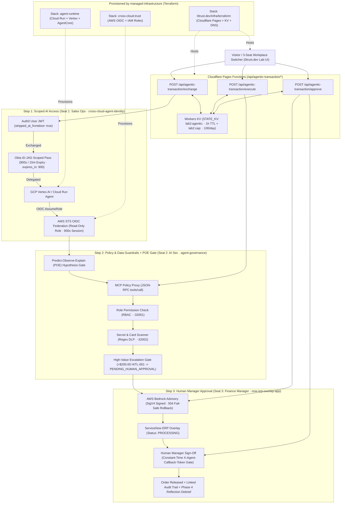

# Lab 2 Architecture: Controlled AI Financial Actions (`/agentic-transaction`)

> **Zoom Level:** 2.5 (Lab Assembly + Infrastructure Mapping)  
> **Parent Overview:** [`docs/ARCHITECTURE.md`](../ARCHITECTURE.md)
> **Experience Archetype:** **Archetype A** (3-Seat Role-Play: *Sales Ops · CRM + AI Copilot* ↔ *AI Sec · MCP Console* ↔ *Finance Manager · Approval Queue*) + **Archetype C** (*Predict–Observe–Explain (POE)* Policy Gate)

---

## 1. End-to-End Lab + `managed-infrastructure` Zoom-In

---

## 2. Distributed Repo & Infrastructure Ownership

| Lab Stage & Seat | Plain-English Purpose | Owning Application Repo | Provisioning Infrastructure (`managed-infrastructure`) |
| :--- | :--- | :--- | :--- |
| **Step 1: Scoped AI Access** *(Seat 1: Sales Ops · CRM + AI Copilot)* | Strip raw login at frontdoor (`stripped_at_frontdoor: true`) and issue a 15-minute (`900s`) single-purpose pass (`expires_in: 900`) | [`cross-cloud-agent-identity`](https://github.com/c2pig/cross-cloud-agent-identity) | `cross-cloud-trust` (AWS OIDC Provider & IAM Role) + `agent-runtime` (GCP Cloud Run / Vertex) |
| **Step 2: Policy & Data Guardrails** *(Seat 2: AI Sec · MCP Console + POE Gate)* | Predict-Observe-Explain check, block leaked secrets (`-32002`) & unauthorized roles (`-32001`), escalate high-value orders (`>$200.00` `HITL-001`) | [`agent-governance`](https://github.com/c2pig/agent-governance) | `agent-runtime` (MCP Policy Proxy & Default-Deny Egress) |
| **Step 3: Human Manager Approval** *(Seat 3: Finance Manager · Approval Queue)* | AI generates SigV4 Bedrock advisory (`PROCESSING`); only constant-time authenticated human callback can set `RELEASED` | [`now-erp-overlay-app`](https://github.com/c2pig/now-erp-overlay-app) | `cross-cloud-trust` (Bedrock SigV4 IAM Role) + ServiceNow Fluent App |
| **Lab UI & Edge Proxy Sandbox** | 3-Seat Role-Play + POE workspace, `/api/agentic-transaction/{exchange,execute,approve}`, sticky `XRayTelemetryDrawer`, `1h TTL` `STATE_KV` | [`0trust.dev`](https://github.com/c2pig/0trust.dev) | [`0trust.dev/infra/terraform`](../../infra/terraform) (Cloudflare Pages, KV, DNS) |

---

## 3. Security Invariants Enforced

1. **Raw User Login Never Leaves the Gateway (`stripped_at_frontdoor: true`)**: Inbound Auth0 user tokens are stripped at the Cloud Run Frontdoor; downstream services only see 15-minute (`900s`, `expires_in: 900`) Okta `oauth-id-jag+jwt` and GCP→AWS STS scoped passes.
2. **Default-Deny Tool & Secret Guardrails**: Any prompt containing secrets/payment cards (`-32002 DLPViolationDetected`) or exceeding role permissions (`-32001 ToolExecutionDenied`) is blocked before reaching the model.
3. **Mandatory Human Sign-Off**: Automated AI flows can only set `PROCESSING` with a SigV4-signed Bedrock advisory note (and roll back to `BLOCKED` on `504` timeout)—only an authenticated human manager callback (`X-Agent-Callback-Token` verified in constant time) can set `RELEASED`.
4. **End-to-End Traceability & Per-Visitor Isolation**: Every step, block, and approval shares a single `correlation_id` and W3C `traceparent` streamed into the sticky bottom `XRayTelemetryDrawer`, isolated per visitor in `STATE_KV` with a `1h TTL` (`expirationTtl: 3600`).
